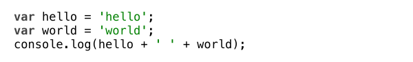

# code2image

[](https://www.npmjs.com/package/code2image)
[](https://www.npmjs.com/package/code2image)
[](https://github.com/kreshikhin/code2image/actions/workflows/ci.yml)

Render a syntax-highlighted PNG from a code snippet. Highlighting is done by [highlight.js](https://github.com/highlightjs/highlight.js), and the image is drawn with [node-canvas](https://github.com/Automattic/node-canvas).

## Requirements

- Node.js 20.9 or newer
- A Cairo-capable build of `canvas`. Current `canvas` releases ship prebuilt binaries for common platforms. If installation compiles from source, install the [node-canvas system libraries](https://github.com/Automattic/node-canvas#compiling) first.

`fontName` has to be a font family installed on the machine that draws the image. The default is `monospace`.

## Installation

```sh
npm install code2image
```

## Usage

```js
const code2image = require('code2image');

const code = [
    "var hello = 'hello';",
    "var world = 'world';",
    "console.log(hello + ' ' + world);"
].join('\n');

code2image.render(code, 'snippet.png', {
    string: 'green',
    keyword: '#444 bold'
}, function (err) {
    if (err) {
        throw err;
    }
});
```



`styles` is optional. Pass the callback as the third argument to keep the theme defaults:

```js
code2image.render(code, 'snippet.png', function (err) {
    if (err) {
        throw err;
    }
});
```

## API

### `render(code, filepath, [styles], callback)`

Draw `code` into a PNG at `filepath`.

- `code` is a string.
- `filepath` is the output path. Parent directories are not created.
- `styles` overrides the [default theme](themes/default.yml).
- `callback(err)` is called after the file is written. `err` is `null` on success.

A shared leading indent is removed before drawing, and tabs are expanded to the width that best matches the surrounding indentation.

### `reduceIndent(code)`

Return `code` with the shared indent removed. Useful if you want the same normalization without drawing.

### `listLanguages()`

Return the language ids highlight.js can recognize. Detection itself is automatic.

## Styles

Defaults live in [`themes/default.yml`](themes/default.yml). Sizes accept a number or a string with a `px` suffix. A token style is a color, optionally followed by a canvas font weight such as `bold`.

| Option | Default | Meaning |
| --- | --- | --- |
| `width` | `600` | Image width in pixels |
| `fontName` | `monospace` | Font family used to draw the code |
| `fontSize` | `18px` | Maximum font size |
| `fontMinSize` | `6px` | Minimum font size for long lines |
| `fontRatio` | `1` | Approximate character width relative to the font size |
| `lineHeight` | `20px` | Distance between baselines |
| `color` | `black` | Default text color |
| `background` | `white` | Background color |
| `keyword`, `string`, `comment`, `number`, … | see the theme | Colors for highlight.js token classes |

Long lines use a smaller font so the snippet fits in `width`. Token classes follow highlight.js names (`keyword`, `string`, `title`, `function`, and so on).

## Examples

The scripts in [`examples/`](examples) read a snippet from the same directory and write a PNG next to it:

```sh
node examples/small.js
node examples/medium.js
node examples/big.js
node examples/64lines.js
```

## Development

```sh
npm install
npm test
```

Tests use the built-in Node.js runner. They render real PNGs and check the image header, size, background, and string color. Continuous integration runs them on Node.js 22, 24, and 25.

## Publishing

Publishing runs from [`.github/workflows/publish.yml`](.github/workflows/publish.yml) when a `vX.Y.Z` tag is pushed, or from the Actions tab with **Run workflow**. A tag has to match `version` in `package.json`. A manual run publishes the version already committed on the selected branch. The workflow authenticates with [npm trusted publishing](https://docs.npmjs.com/trusted-publishers/), so GitHub does not store an npm token. Provenance is attached automatically when the repository is public.

A maintainer connects the workflow once, from npm 11.15 or newer:

```sh
npm login
npm trust github code2image \
  --repo kreshikhin/code2image \
  --file publish.yml \
  --allow-publish
```

The same fields can be entered under the package's Trusted Publisher settings on npmjs.com. The workflow file has to be on the default branch before that connection is created, and the first publish has to succeed within two days.

```sh
git tag v1.0.0
git push origin v1.0.0
```

## License

[MIT](LICENSE)
